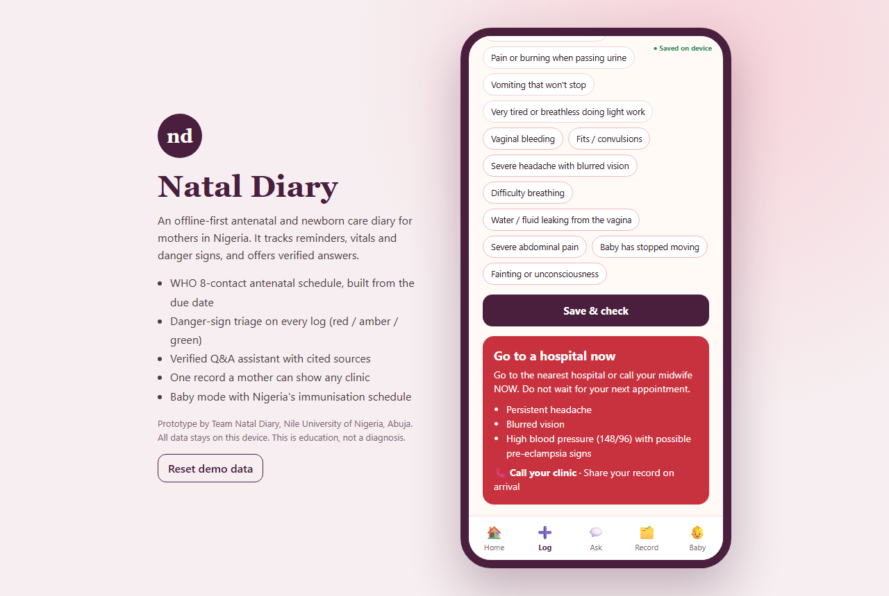

# Natal Diary

**An offline-first antenatal and newborn care diary for mothers in Nigeria.**

Live demo: https://walimedugu.github.io/natal-diary/ (works on any phone browser, and offline after the first visit)

Demo video: [media/Natal_Diary_Demo.mp4](media/Natal_Diary_Demo.mp4) · Pitch deck: [media/Natal_Diary_Pitch_Deck.pdf](media/Natal_Diary_Pitch_Deck.pdf)



## The problem

Nigeria accounts for about 29% of the world's maternal deaths (WHO / UN MMEIG, 2025). Many of these deaths are preventable. Antenatal visits, tests and postnatal follow-ups are missed, danger signs such as pre-eclampsia are spotted late, and records live on paper cards that get lost between clinics.

We surveyed pregnant and recently pregnant women (Nov 2026):
- 87.5% already track their weight, blood pressure and baby's movement, but on paper or from memory.
- 87.5% rated appointment reminders, vaccination tracking and messaging a health worker as the most valuable features.
- 87.5% want health tips and warnings matched to their week of pregnancy.

## What the prototype does

| Screen | What it does |
|---|---|
| **Home** | Shows the gestational week from the due date, the next antenatal contact, missed-visit alerts, Td vaccine reminders and a tip for the current week. |
| **Log** | 30-second check-in (BP, weight, temperature, kick count, symptoms). Each log runs through the **danger-sign triage engine**: red = go to a hospital now, amber = call your clinic today, green = keep logging. |
| **Ask** | A Q&A assistant that answers **only from a verified library** of 28 entries, each with a cited source. An emergency-word safety layer always answers "go to hospital now" first. |
| **Record** | One record a mother can show any clinic: the WHO 8-contact plan with done/missed status, check-in history, visit notes and a shareable summary. |
| **Baby** | After delivery, the app becomes the baby's diary, with Nigeria's NPHCDA routine immunisation schedule and postnatal check reminders. |

All data stays on the device (localStorage). A service worker caches the app so it works offline.

## How the AI / decision support works

- **Triage engine** ([src/triage.js](src/triage.js)) is a transparent rule system built from WHO antenatal care guidance and the Nigerian FMoH danger-sign list. Its thresholds:
  - Blood pressure: 140/90 or above is amber; 160/110 or above is red. Raised BP after 20 weeks together with headache, visual change, swelling or epigastric pain is red (possible pre-eclampsia).
  - Temperature: 38°C or above is amber; 39°C or above is red.
  - Fetal movement after 28 weeks: fewer than 10 kicks in 2 hours is amber; none is red.
  - Every result lists the reasons that triggered it.
- **Assistant** ([src/kb.js](src/kb.js)) uses TF-IDF retrieval with a Nigerian-English synonym map (for example "agbo", "fefol" and "pee"). It answers only when retrieval is confident and always shows the source. If it isn't confident, it says so and refers the mother to her midwife. It never generates free text.

We chose retrieval and rules over a generative model on purpose. For pregnancy safety, every answer must be traceable to a source, and the app must run offline on low-end phones.

## Evaluation

Run it with `node eval/evaluate.js` ([full output](eval/results.txt)).

| Component | Test set | Result |
|---|---|---|
| Triage, exact level | 40 labelled vignettes | 40/40 (100%) |
| Triage, emergency (red) sensitivity | 19 red cases | 19/19 (100%) |
| Triage, green specificity | 8 green cases | 8/8 (100%) |
| Assistant top-1 (baseline v0) | 30 paraphrased questions | 22/30 (73.3%) |
| Assistant top-1 (after error analysis) | same 30 questions | 28/30 (93.3%) |
| Assistant top-3 | same 30 questions | 29/30 (96.7%) |

**Limitations, stated honestly:**
- The vignettes were written by our team from the same guidelines the rules encode. They check that the rules are implemented correctly; they are **not clinical validation**.
- The assistant's synonym map was improved after looking at errors on the same 30 questions, so 93% is optimistic. A held-out set from real mothers' questions is next.
- One remaining miss ("I'm seeing blood…") is caught by the emergency safety layer, so the mother still gets "go to hospital now" first.
- The library must be reviewed by a licensed midwife before any pilot.

**Who benefits / who could be harmed:**
- **Who benefits:** pregnant women who miss visits or can't tell which symptoms are urgent, and midwives who need follow-up.
- **Risks:** false reassurance (a green result when something is wrong) and over-reliance on the app.
- **Mitigations:** the triage thresholds are deliberately conservative, every screen says it is not a diagnosis, and any red flag routes the mother to a human.

## Run locally

```bash
git clone https://github.com/WaliMedugu/natal-diary
cd natal-diary
python -m http.server 8765   # then open http://localhost:8765
node eval/evaluate.js        # run the evaluation
```

There is no build step and there are no dependencies.

## Roadmap

1. Usability tests with 10 mothers and 2 midwives.
2. Flutter Android app with encrypted storage and SMS reminders.
3. Clinic dashboard.
4. Pilot in 2 Abuja clinics, measuring on-time antenatal visit completion.

## Team

Team Natal Diary, Software Engineering, Nile University of Nigeria, Abuja: Joan Azike, Wali Medugu, Adekola, Mutma, Divine, Amarachi, Elsa, Mark, Muna, Afoma, Daze.

*This prototype is for education. It is not a medical device and does not give a diagnosis.*
